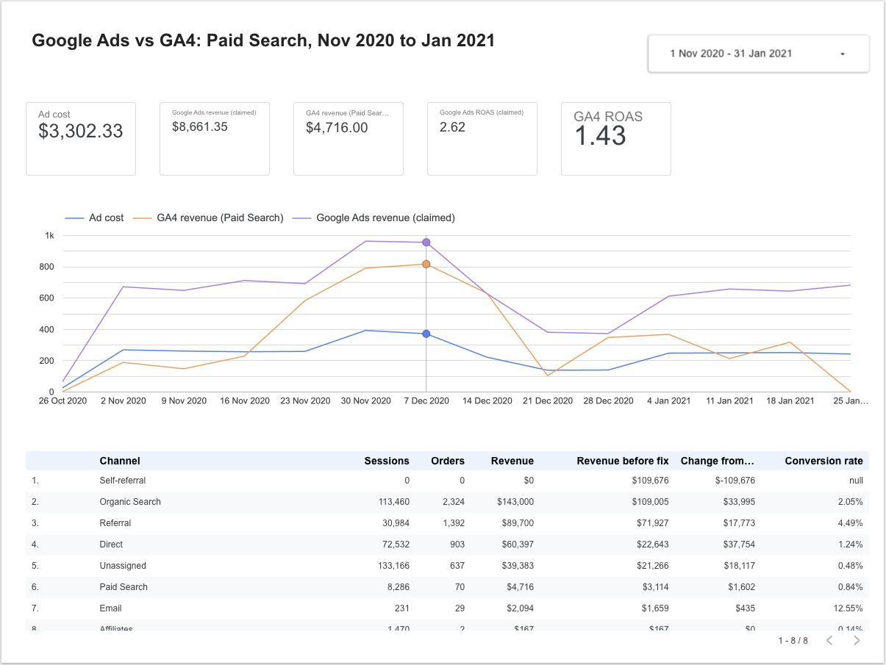
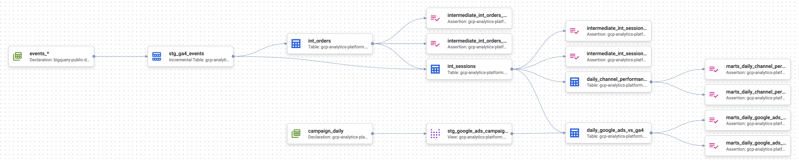

# gcp-analytics-platform

Google Ads says its Paid Search campaigns returned $2.62 for every $1 spent. GA4 says $1.43. This project builds one place in BigQuery where both numbers are computed the same way, explains the gap, and refreshes it automatically.

- **Data:** the public GA4 e-commerce sample (Google Merchandise Store, 2020-11-01 to 2021-01-31) plus a synthetic Google Ads campaign report.
- **Transform:** Dataform (SQLX) on BigQuery, with assertions.
- **CI/CD:** GitHub Actions with Workload Identity Federation (no service account keys).
- **Report:** Looker Studio.



## Architecture

```text
bigquery-public-data.ga4_obfuscated_sample_ecommerce.events_*      raw_google_ads.campaign_daily
                         │                                             (synthetic, scripts/)
                         ▼                                                      │
staging       stg_ga4_events (incremental, partitioned by day)     stg_google_ads_campaign_daily
                         │                                                      │
intermediate  int_orders ──► int_sessions (channel + self-referral fix)         │
                         │                                                      │
marts         daily_channel_performance        daily_google_ads_vs_ga4 ◄────────┘
                         │                                │
                         └──────────► Looker Studio ◄─────┘
```



| Layer | Model | What it does |
|---|---|---|
| staging | `stg_ga4_events` | Flattens the event params the models need. Incremental with a 3-day lookback for late events. |
| staging | `stg_google_ads_campaign_daily` | Renames connector columns, tags rows as `google / cpc`. |
| intermediate | `int_orders` | One row per transaction ID. Purchases without an ID count as their own order. |
| intermediate | `int_sessions` | Session = `user_pseudo_id` + `ga_session_id`. Source is the first non-null source in the session. Self-referral sessions take the user's previous channel, or Direct. |
| marts | `daily_channel_performance` | Sessions, orders and revenue by date and channel, before and after the self-referral fix. |
| marts | `daily_google_ads_vs_ga4` | Google Ads cost and claimed conversions next to GA4 Paid Search sessions, orders and revenue. |

Every intermediate and mart model has assertions on unique and non-null keys (for example one row per `date` × `channel`).

## Findings

From [docs/exploration.md](docs/exploration.md) and the marts:

- **Duplicate purchases inflate revenue by 6.5%.** 326 transactions were recorded more than once. Summing raw `purchase` events gives $362k; deduplicated revenue is $340k.
- **16% of purchases have no transaction ID** (`(not set)`), a tagging gap. They are kept as separate orders, not dropped.
- **Self-referral holds 32% of revenue.** Sessions restart when users move between the store's own subdomains, so the purchase is credited to the store itself. After reassigning these sessions, Paid Search revenue rises from $3,114 to $4,716.
- **Google Ads ROAS 2.62 vs GA4 ROAS 1.43** on the same $3,302 of spend. Google Ads counts conversions with a 30-day click window across devices; GA4 credits the session source. Neither is wrong, but a report has to say which one it shows.

## CI/CD

[.github/workflows/dataform.yml](.github/workflows/dataform.yml):

- **Pull request:** builds every model into `*_ci` datasets with `--full-refresh` and runs assertions. A broken model fails the PR without touching production tables.
- **Push to main:** builds production datasets.
- **Daily schedule:** incremental run, as it would run against a live GA4 export.

GitHub authenticates to GCP through Workload Identity Federation, limited to this repository ([scripts/setup_wif.sh](scripts/setup_wif.sh)). The repo is also linked to a GCP Dataform repository so the code can be browsed in the console ([scripts/setup_dataform_repo.sh](scripts/setup_dataform_repo.sh)). Scheduling stays in GitHub Actions.

## Synthetic Google Ads data

The GA4 sample has no ad spend, so [scripts/gen_ad_spend.py](scripts/gen_ad_spend.py) generates a daily campaign report shaped like a Supermetrics load. These values are assumptions, not real data:

- Three campaigns (Brand, Apparel, Shopping) with fixed CPC, CTR and conversion rates.
- Daily volume follows the GA4 sample: weekends at 60%, a peak from Cyber Monday to mid December, a holiday dip.
- Clicks are sized to roughly match the ~83 `google / cpc` sessions a day in GA4.
- Platform-reported conversions are set to about 2.5x what GA4 sees, to reproduce the usual gap.
- Fixed random seed, so every run produces the same file.

## Reproduce

Requires a GCP project with BigQuery, [mise](https://mise.jdx.dev) and gcloud.

```bash
cp .env.example .env              # set GCP_PROJECT_ID, BQ_LOCATION=US
gcloud auth application-default login
mise run setup                    # tools, venv, gcloud project, .df-credentials.json

python scripts/gen_ad_spend.py    # data/google_ads_campaign_daily.csv
scripts/load_ad_spend.sh          # raw_google_ads.campaign_daily

dataform compile .
dataform run .                    # staging, intermediate, marts, assertions
```

For CI, run `scripts/setup_wif.sh` and store the printed values as GitHub Actions variables (`GCP_PROJECT_ID`, `WIF_PROVIDER`, `WIF_SERVICE_ACCOUNT`).

A full build reads about 3.4 GB, well inside the BigQuery free tier. Exploration queries are in [sql/adhoc/](sql/adhoc/).
